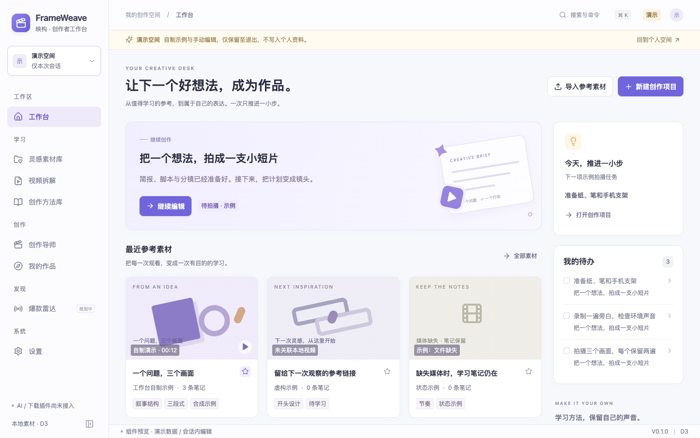
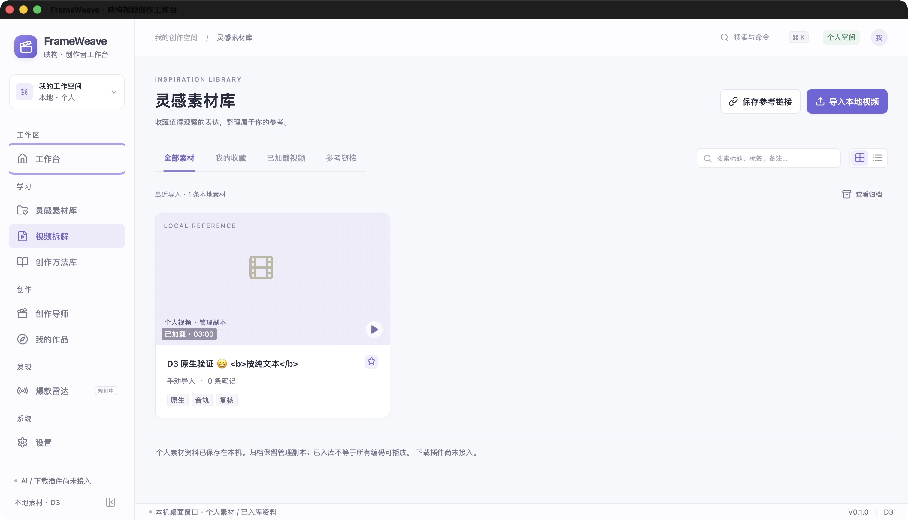
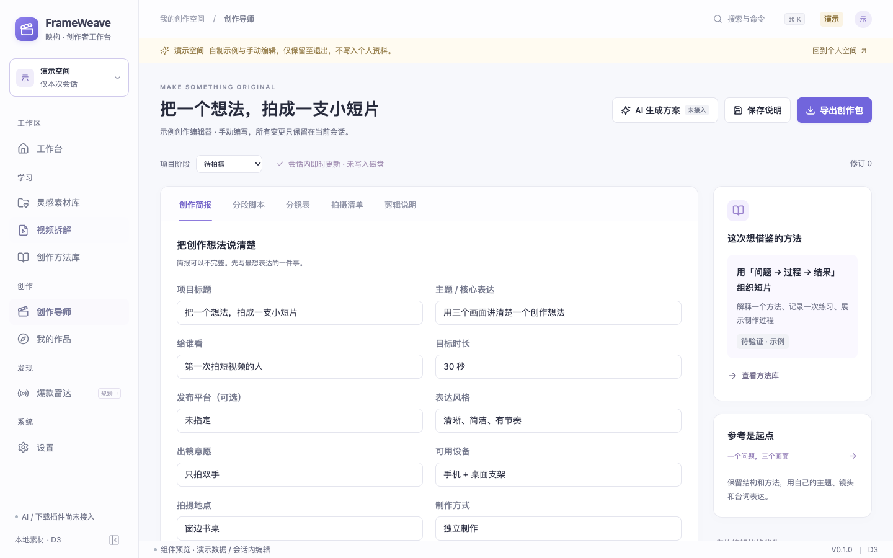

# FrameWeave · 映构

**视频创作者的本地工作台。**

收藏值得学习的视频，整理参考素材，把观察逐步变成自己的创作计划。FrameWeave 希望把素材管理、视频拆解、脚本与分镜、方法积累和作品复盘放进一个安静的桌面空间。

当前为 **v0.1.0 · D3 本地素材预览版**，面向 macOS。已实现个人视频的导入、管理与播放；创作流程可在独立演示空间体验。

[快速开始](#快速开始) · [功能状态](#功能状态) · [开发与检查](#开发与检查) · [项目文档](#项目文档)



_工作台界面，来自浏览器组件预览中的演示空间。图中的示例项目与创作编辑仅在本次会话有效。_

## 现在可以做什么

- **整理本地视频**：通过 macOS 原生文件选择器批量导入，复制为应用管理副本，显示逐项进度，支持取消与内容去重。
- **保存素材资料**：编辑标题、标签和备注，搜索、筛选、收藏、归档与恢复；个人素材资料保存到本机 SQLite，重启后保留。
- **观看与观察**：播放本地管理副本，暂停、跳转进度和调整倍速；原文件移走后仍可使用已导入的副本。
- **体验创作流程**：在演示空间查看自制短片和手写拆解，手动编辑创作简报、分段脚本、分镜、拍摄清单与复盘。
- **使用桌面交互**：原生菜单、快捷键、单实例唤回、窗口与页面恢复，以及未保存资料和导入任务的退出保护。

应用包含工作台、灵感素材库、视频拆解、创作导师、创作方法库、我的作品、爆款雷达和设置八个页面，各页面的可用范围见下表。

## 功能状态

| 能力                               | 当前状态                                             |
| ---------------------------------- | ---------------------------------------------------- |
| 个人素材库                         | 已实现本地导入、资料持久化、搜索、收藏、归档与恢复   |
| 本地视频播放                       | 已实现播放、暂停、进度跳转与倍速；解码能力取决于系统 |
| 拆解、字幕与时间笔记               | 可查看手写演示；个人字幕与时间笔记尚未接入           |
| 项目、脚本、分镜、方法卡与作品复盘 | 演示空间可手动编辑；个人数据持久化尚未接入           |
| AI 拆解、AI 创作与语音转写         | 尚未接入                                             |
| 视频下载插件、爆款雷达与榜单采集   | 尚未接入                                             |
| 创作包导出、产品备份恢复与云同步   | 尚未接入                                             |

导入接受 **MP4 / MOV 候选文件**，每批最多 **20 个**，单文件最多 **5 GiB**。入库成功与可播放分别判断；目前原生播放记录覆盖自制 H.264/AAC MP4，不承诺所有 MOV 或其他编码都可播放，也不自动转码。

<details>
<summary>查看更多界面</summary>

### D3 原生个人素材库



真实 macOS 窗口，内容为隔离验收中使用的自制测试素材。

### 创作编辑器演示



浏览器组件预览。简报、脚本、分镜与清单为会话内手动编辑，AI 和导出入口尚未接入。

</details>

## 快速开始

### 开发环境

- **macOS**：工程配置最低版本为 12.0，当前原生构建与验收记录来自 Apple Silicon；其他机器和系统版本仍需验证。
- **Node.js 22（≥ 22.12）或 24**，以及 npm。
- **Rust / Cargo** 稳定工具链。
- **Xcode Command Line Tools**；尚未安装时可运行 `xcode-select --install`。

```sh
git clone https://github.com/SharkyTang/frameweave.git
cd frameweave/apps/desktop
npm ci
npm run desktop:dev
```

`desktop:dev` 会启动 Vite 和 Tauri 原生窗口。启动脚本也会自动识别工程内已有的 `.toolchains/cargo`，无需手动修改系统 PATH。

首次启动进入空的个人空间。可以导入自己的本地视频，也可以通过左上角空间切换进入演示空间，体验内置的 12 秒自制短片与创作流程。演示编辑与个人资料隔离，退出后恢复初始示例。

### 构建桌面应用

在 `apps/desktop` 下运行：

```sh
npm run desktop:build
```

生成的应用位于：

```text
apps/desktop/src-tauri/target/release/bundle/macos/FrameWeave.app
```

构建后的 `.app` 内置界面、图标与示例资源，可独立启动，运行时不需要开发服务器、Node.js、Python 或 API Key。当前采用本机 ad hoc 签名，尚未完成 Developer ID 签名和公证；应用包和 ZIP 不随源码提交。

## 本地数据

Rust 原生层管理 SQLite 与媒体文件。macOS 默认资料目录为：

```text
~/Library/Application Support/com.sharkytang.frameweave.workbench/
├── shell.json                # 窗口与页面偏好
├── data/frameweave.sqlite3   # 个人素材资料
├── media/originals/          # 导入视频的管理副本
├── staging/                  # 导入过程的暂存文件
└── recovery/                 # 数据库迁移前快照
```

导入会复制视频，保留原文件，因此需要额外磁盘空间。归档保留媒体副本，当前未提供永久删除或产品备份恢复操作。个人业务数据不放入浏览器 localStorage。

当前应用没有账号、云同步或遥测，也未接入远程 AI、下载与榜单服务；生产界面不加载远程字体、图片或脚本。实际系统断网验收仍有待完成，详见原生验收记录。

## 开发与检查

技术栈：**Tauri 2 · Rust · SQLite / rusqlite · React 19 · TypeScript · Vite**。测试使用 Vitest、Rust 测试与 Playwright。

以下命令均在 `apps/desktop` 下运行：

| 命令                    | 用途                      |
| ----------------------- | ------------------------- |
| `npm run desktop:dev`   | 启动原生桌面开发环境      |
| `npm run ui:dev`        | 启动浏览器组件预览        |
| `npm run typecheck`     | TypeScript 类型检查       |
| `npm test`              | 组件与业务逻辑测试        |
| `npm run native:test`   | Rust 原生层测试           |
| `npm run ui:build`      | 检查并构建前端            |
| `npm run test:ui`       | Playwright 浏览器界面测试 |
| `npm run desktop:build` | 构建 macOS `.app`         |

浏览器预览不提供个人原生导入或 SQLite 访问。运行 Playwright 前，先在另一个终端启动 `npm run ui:dev`；测试连接 `http://127.0.0.1:1420`，当前配置使用本机 `/Applications/Google Chrome.app`。

D3 已记录的历史自动化结果为 **25 项组件/逻辑测试、27 项 Rust 测试、10 项浏览器测试通过**。原生验收记录为 **50 PASS / 3 MANUAL_PENDING / 1 NOT_RUN**，尚需补充导入内存采样、特定不可解码样本、真实中文输入法和实际断网检查。这些记录的范围与证据见下方文档。

## 仓库结构

```text
apps/desktop/
├── src/              # React 界面、领域模型与数据适配器
├── src-tauri/        # Rust 原生层、SQLite、导入与媒体访问
├── public/demo/      # 内置自制演示媒体
├── tests/            # 组件、逻辑与浏览器测试
└── scripts/          # 开发、构建与演示资源工具
docs/desktop-workbench/
└── frameweave-d3/    # D3 交接、数据契约、验收与截图
```

## 项目文档

- [D3 交接与阶段边界](docs/desktop-workbench/frameweave-d3/D3_HANDOFF.md)
- [D3 数据契约](docs/desktop-workbench/frameweave-d3/D3_DATA_CONTRACT.md)
- [原生验收与待验项目](docs/desktop-workbench/frameweave-d3/D3_NATIVE_VALIDATION.md)
- [自动化检查记录](docs/desktop-workbench/frameweave-d3/D3_TEST_RESULTS.json)
- [完整截图索引](docs/desktop-workbench/frameweave-d3/D3_SCREENSHOT_INDEX.md)
- [早期 D2 交接](docs/desktop-workbench/handoffs/D2_HANDOFF.md)与[品牌更名记录](docs/desktop-workbench/REBRAND_HANDOFF.md)（历史资料）

问题与建议可通过 [GitHub Issues](https://github.com/SharkyTang/frameweave/issues) 反馈。
